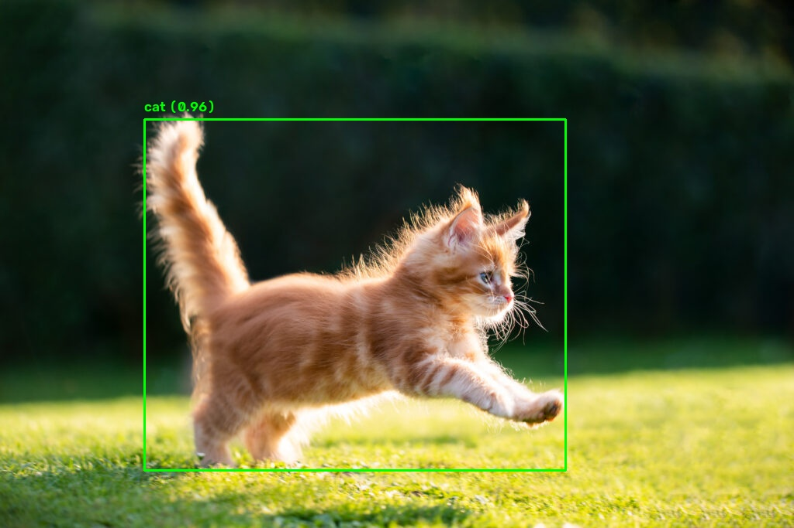
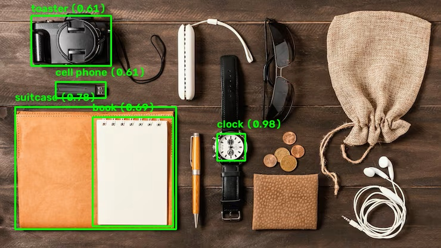
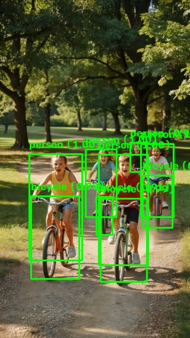

# Image-caption-tagger

Automatic image captioning, object detection, and hashtag extractor using Hugging Face (`BLIP`, `CLIP`) and PyTorch (`Faster R-CNN` / OpenCV).


## Features

1. **Image Captioning (`captioner.py`):** Generates a short text description of what's happening in the image.

2. **Object Detection (`detector.py`):** Finds objects and saves a new image with bounding boxes (`output_detected.jpg`).

3. **Hashtag Extraction (`tagger.py`):** Suggests relevant hashtags that match the photo.


## Requirements (with versions tested on)

1. python (3.14.9)
2. torch (2.15.0+cpu)
3. torchvision (0.29.2+cpu)
4. transformers (5.24.1)
5. opencv-python (5.1.0)
6. pillow (13.0.0)


## Installation
   ```bash
   pip install -r requirements.txt
   ```


## Example Results

| *Input Image* | *Object Detection Result* |
| :---: | :---: |
|  |  |
|  |  |
|  |  |


## Key Points

1. **How it works (Pipeline):**
   * Loads the input image and converts it into the required RGB/BGR tensor formats.
   * **Captioning:** Generates a natural language sentence describing the scene (`captioner.py`).
   * **Detection:** Detects objects, filters out low-confidence predictions, draws bounding boxes with labels, and saves `output_detected.jpg` (`detector.py`).
   * **Tagging:** Computes image-text similarity against candidate tags and selects the top matching hashtags (`tagger.py`).

2. **Assumptions:**
   * Input images are standard RGB/BGR photos (`JPG`, `PNG`) with clear visual subjects.
   * Object detection assumes target objects belong to the 80 standard COCO dataset categories.
   * Hashtag extraction assumes relevant keywords are included in the predefined candidate tag pool.

3. **Models & Configuration Details:**
   * **Image Captioning:** Uses Hugging Face `Salesforce/blip-image-captioning-base` (`BlipProcessor` & `BlipForConditionalGeneration`).
   * **Object Detection:** Uses PyTorch `fasterrcnn_resnet50_fpn` (pretrained on COCO) with OpenCV (`cv2`) for drawing bounding boxes and confidence labels.
   * **Hashtag Extraction:** Uses Hugging Face `openai/clip-vit-base-patch32` (`CLIPProcessor` & `CLIPModel`) for zero-shot cosine similarity ranking.


## Limitations

The results are pretty decent overall, though not always perfect because of a few limits in the pre-trained models:

1. **Only 80 object categories (COCO):** BLIP can describe specific items like a *pink planner* or *pen*, but Faster R-CNN only knows 80 COCO labels. So it sometimes guesses the closest shape instead (like labeling a *pen* as a *toothbrush*, or a *planner* as a *book*).

2. **Small or hidden objects:** If objects are too small or overlapping each other, the detector might miss them.

3. **General hashtags:** Since CLIP picks from a fixed tag list, the hashtags are mostly broad topics (like `#travel` or `#sports`) rather than very specific words.
